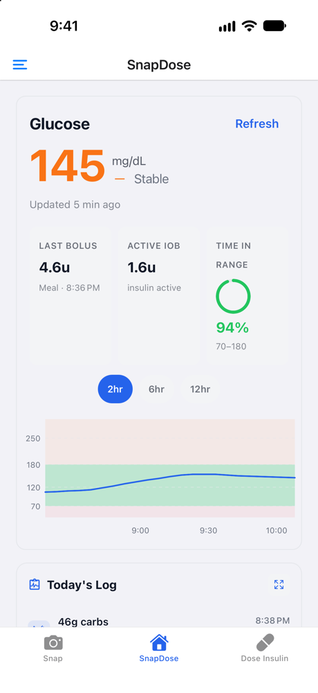
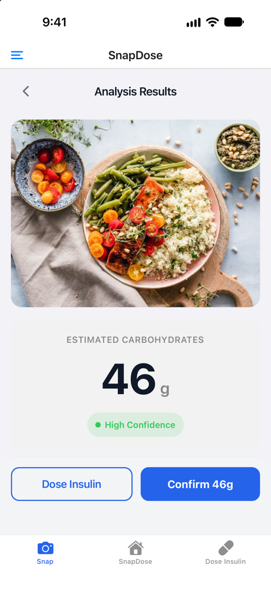
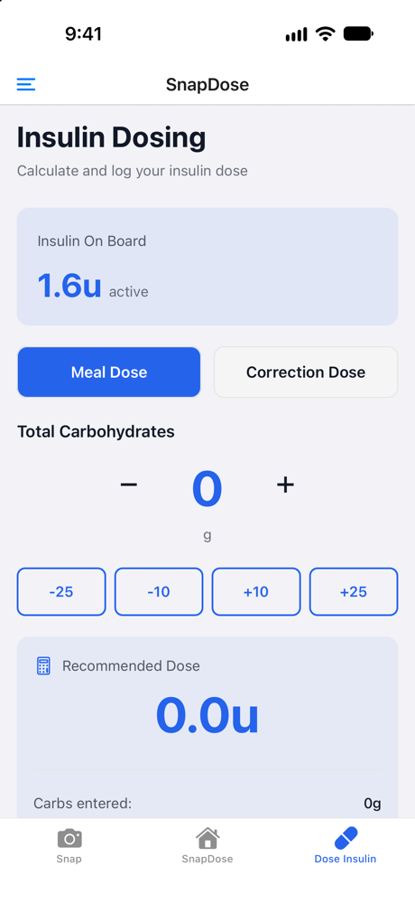
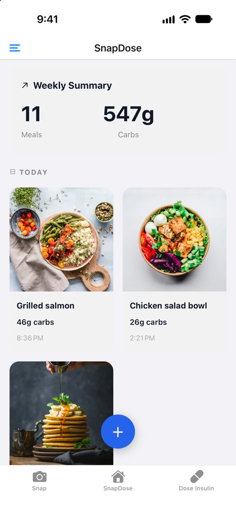

<p align="center">
  
</p>

<h1 align="center">SnapDose</h1>

<p align="center">
  <b>Snap a photo of your meal, get a carb estimate, and send the insulin dose to your pump from one app.</b><br>
  A Type 1 Diabetes app built as a junior design project at California Baptist University.
</p>

<p align="center">
  <a href="#run-it-locally"><b>Run it locally</b></a>
  &nbsp;·&nbsp;
  <a href="#how-it-works">How it works</a>
  &nbsp;·&nbsp;
  <a href="#team">Team</a>
</p>

<p align="center">
  
  
  
</p>

<p align="center">
  
  &nbsp;
  
  &nbsp;
  
  &nbsp;
  
</p>

People with Type 1 Diabetes juggle three or four apps to manage one meal: a CGM app for glucose, a food app or mental math for carbs, a calculator for the dose, and the pump's own app to deliver it. Every hand-off is a chance to enter the wrong number, and a wrong number means a wrong insulin dose.

SnapDose puts that loop in one place. It shows live glucose from Dexcom, estimates carbs from a photo with Gemini, calculates the bolus from your insulin-to-carb ratio, correction factor, and insulin on board, and sends it to a pump. The pump is simulated on an M5Stack Tab5, so no real insulin is ever delivered.

SnapDose was built for EGR 302, the junior design course at California Baptist University, over the Spring 2026 semester. It is a student project and not a medical device.

## What it does

- **Live glucose.** Current reading, trend, time in range, and a 2, 6, or 12 hour graph from the Dexcom API.
- **Carbs from a photo.** Take a picture and Gemini returns the foods it sees, a carb estimate, and a confidence level. You can edit the number before using it.
- **Dose calculator.** Meal and correction doses from your ratios, minus insulin still on board.
- **Pump delivery.** Confirmed doses go to the Spring Boot API, and the pump simulator picks them up over Wi-Fi and acknowledges delivery.
- **Food gallery.** Every meal with its photo, carbs, and detected foods, grouped by day with a weekly summary.
- **Onboarding and settings.** Sign up with Firebase Auth and set your insulin ratios and target glucose range. Connect Dexcom and pair the pump from Settings.

## How it works

```
React Native app (Expo)
  ├── meal photo ──> Cloud Storage ──> Cloud Function ──> Gemini ──> Firestore ──> app
  ├── dose ────────> Spring Boot API (Cloud Run) <──── polls ──── M5Stack Tab5 pump simulator
  └── glucose <──── Dexcom OAuth function <──── Dexcom API
```

Carb estimation is event driven. The app uploads the photo and listens on Firestore, and the Cloud Function writes the estimate when Gemini finishes, so the app never blocks on the model.

| Directory | What it is |
|---|---|
| [`react-native-app`](react-native-app) | The mobile app. React Native, Expo SDK 54, expo-router, Firebase Auth and Firestore. |
| [`spring-boot-api`](spring-boot-api) | Java Spring Boot API on Cloud Run for bolus, basal, and device pairing. Verifies Firebase tokens for the app and device tokens for the pump. |
| [`gcp`](gcp) | Cloud Function that sends uploaded meal photos to Gemini and writes the carb estimate to Firestore, plus a scheduled cleanup of old dose records. |
| [`dexcom-oauth`](dexcom-oauth) | Cloud Function that handles the Dexcom OAuth flow and returns glucose readings. |
| [`firmware`](firmware) | PlatformIO firmware for the M5Stack Tab5 (ESP32-P4) pump simulator. |

## Run it locally

You need Node.js (LTS) and either Xcode, Android Studio, or Expo Go on a phone.

```sh
git clone https://github.com/cbu-jr-design-26/snap-dose.git
cd snap-dose/react-native-app
npm install
```

Create `react-native-app/.env` with your Firebase web app config:

```sh
EXPO_PUBLIC_FIREBASE_API_KEY=
EXPO_PUBLIC_FIREBASE_AUTH_DOMAIN=
EXPO_PUBLIC_FIREBASE_PROJECT_ID=
EXPO_PUBLIC_FIREBASE_STORAGE_BUCKET=
EXPO_PUBLIC_FIREBASE_MESSAGING_SENDER_ID=
EXPO_PUBLIC_FIREBASE_APP_ID=
```

Then start the app and press `i` for iOS, `a` for Android, or scan the QR code with Expo Go:

```sh
npx expo start
```

The backend services deploy to Google Cloud. `gcp/deploy.sh` deploys the Gemini function, `spring-boot-api/cloudbuild.yaml` builds and deploys the API, and the firmware builds with `pio run` from `firmware/`.

## Team

| Name | Role |
|---|---|
| Ryan Stoffel | Team Lead |
| Payton Henry | Project Lead |
| Micah Suk | Developer |
| Mili Anderson | Developer |
| Elijah Tabor | Developer |

EGR 302: Junior Design Project, Spring 2026, California Baptist University. Advised by Dr. Dan Grissom.
